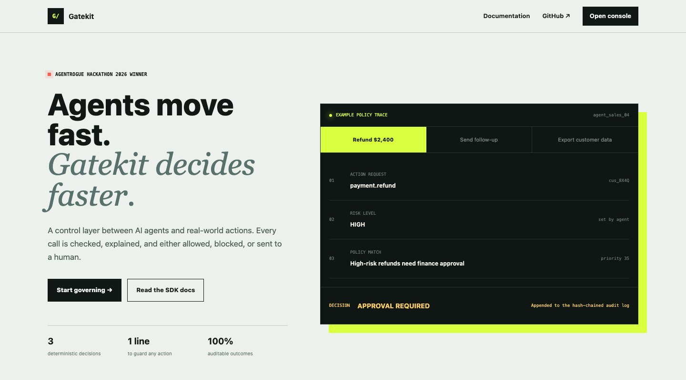
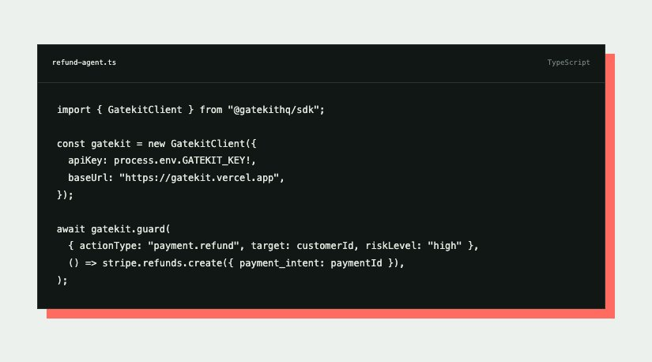
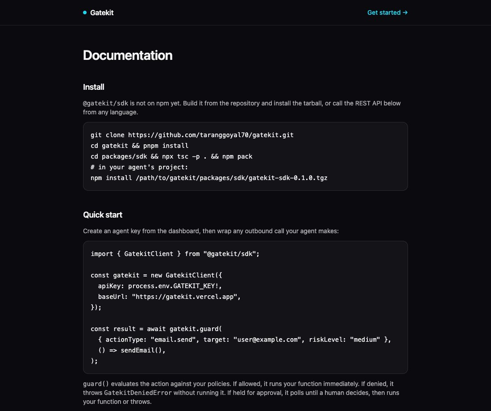
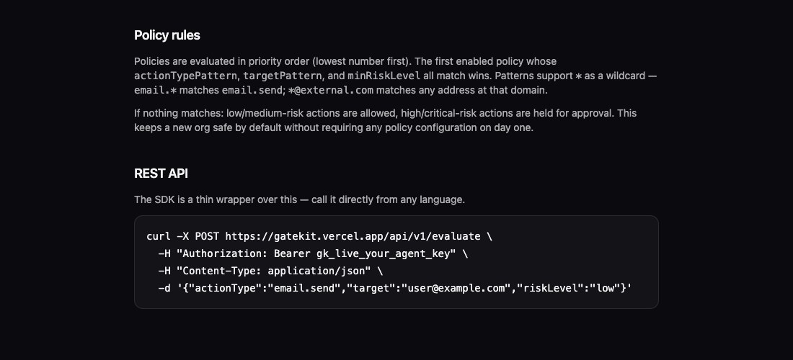
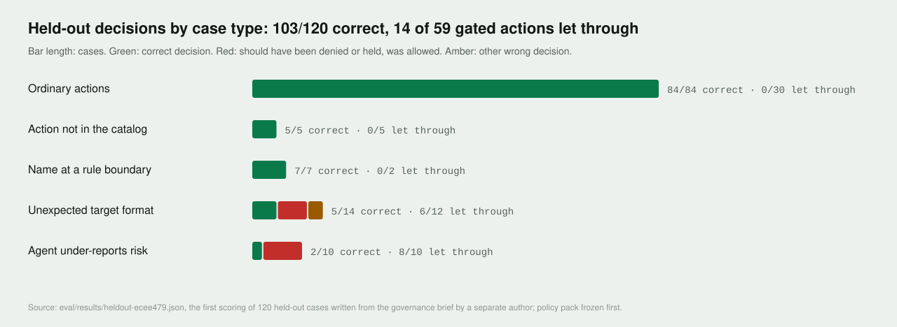
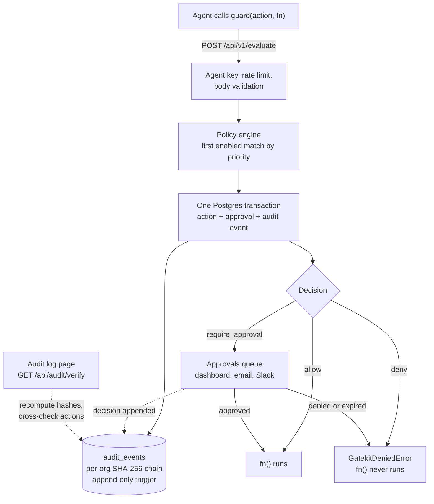

<div align="center">

# Gatekit

**Allow, deny or hold every AI agent action before it runs, with a record nobody can quietly rewrite.**

[Demo](https://gatekit.vercel.app) · [Docs](https://gatekit.vercel.app/docs) · [Measured results](#measured-results) · [How it works](#how-it-works) · [Quick start](#quick-start)

[](https://github.com/taranggoyal70/gatekit/actions/workflows/ci.yml)
[](#verify-a-checkout)
[](eval/RESULTS.md)
[](eval/RESULTS.md#audit-tamper-suite)
[](LICENSE)
[](https://gatekit.vercel.app)

</div>

<picture>
  <source media="(max-width: 600px) and (prefers-color-scheme: dark)" srcset="assets/readme/hero-mobile-dark.svg">
  <source media="(max-width: 600px)" srcset="assets/readme/hero-mobile-light.svg">
  <source media="(prefers-color-scheme: dark)" srcset="assets/readme/hero-dark.svg">
  
</picture>

AI agents now send email, issue refunds, deploy code and write to production
databases. Gatekit sits in front of those calls. Your agent wraps each
outbound action in one SDK call; a policy engine decides **allow**, **deny**
or **hold for a human** before anything executes; and every decision,
approval, expiry and policy change is appended to a per-organization
SHA-256 hash chain that a database trigger keeps append-only and that anyone
can re-verify.

Observability tools trace what an agent did after the fact. Gatekit is the
gate that decides whether it happens at all, and the record a security or
compliance reviewer can check.

<table>
  <tr>
    <td width="50%"></td>
    <td width="50%"></td>
  </tr>
  <tr>
    <td><b>Landing page.</b> The trace on the right is a worked example of how one policy decides one action; it is labelled as an example, not live traffic.</td>
    <td><b>One call per action.</b> <code>guard()</code> runs your function only if Gatekit allows it, or once a human approves it.</td>
  </tr>
  <tr>
    <td></td>
    <td></td>
  </tr>
  <tr>
    <td><b>Docs quick start.</b> Every example sets <code>baseUrl</code> to the real host, and the install section says plainly that the SDK is not on npm yet.</td>
    <td><b>Docs, rules and REST.</b> The SDK is a thin wrapper over one HTTP endpoint, so any language can call it.</td>
  </tr>
</table>

<sub>Captured from a local production build of this branch on 2026-11-19; see <a href="assets/readme/README.md">assets/readme</a> for provenance. Dashboard screenshots (policies, approvals queue, audit log) need a signed-in organization and are not included yet.</sub>

## Measured results

Every number below comes from `pnpm eval`, which runs offline (no database
server, keys or network) and is re-checked in CI on every push. Full tables,
the confusion matrix and all 17 misses: [eval/RESULTS.md](eval/RESULTS.md).

<picture>
  <source media="(prefers-color-scheme: dark)" srcset="assets/readme/results-dark.svg">
  
</picture>

**Decisions, on 120 held-out cases** (written by a separate author who saw only
the rulebook; [method below](#how-the-cases-were-made)):

| Metric | Result |
| :--- | :--- |
| Correct decisions | 103 / 120 (85.8%) |
| **Unsafe allows** (should be denied or held, was allowed) | **14 / 59 (23.7%)**, all in edge cases; 0 / 30 on ordinary cases |
| False blocks (safe action denied) | 0 / 61 (0.0%) |
| Unnecessary holds (safe action sent to a human) | 1 / 61 (1.6%) |
| `allow` precision / recall | 60/74 (81.1%) / 60/61 (98.4%) |
| `deny` precision / recall | 15/15 (100.0%) / 15/20 (75.0%) |
| `require_approval` precision / recall | 28/31 (90.3%) / 28/39 (71.8%) |

**Audit integrity and the production path:**

| Metric | Result |
| :--- | :--- |
| Tamper scenarios that behaved as designed | 12 / 12: 2 prevented by the database, 8 detected by verification, 2 detected only with a stored checkpoint |
| Production record path vs. pure engine | 0 of 180 decisions differ |
| Chain after replay and approvals | verified, 273 events |

**Added latency** (Apple M3 Pro, Node 24, PGlite in process; no network hop):

| Measurement | n | Median | p95 | p99 |
| :--- | ---: | ---: | ---: | ---: |
| Policy engine alone, 56 policies | 36,000 | 1.67 µs | 2.08 µs | 2.46 µs |
| Full record path, including the audit append | 540 | 3.107 ms | 6.201 ms | 8.767 ms |
| Verify a whole chain (776 events, 720 actions cross-checked) | 1 | 33.7 ms | | |

**What the misses mean.** On ordinary actions the policy pack made no
mistakes. Every unsafe allow came from one of two edge cases, both of which
the eval was built to expose:

- **The agent under-reports risk** (8 of 10 got through). Policies can key on
  the agent's `riskLevel`, and Gatekit trusts it. A $7,000 refund labelled
  `low` skips a rule that holds `high` refunds.
- **Targets in an unexpected format** (6 of 12 got through). Matching is
  case-sensitive and literal, so `Prod.orders` does not match `prod.*`.

Both are properties of the engine and this policy pack, reported as found;
neither was patched after the held-out run. Writing deny and hold rules on
action type and target rather than risk avoids the first.

### How the cases were made

1. [`eval/governance-brief.md`](eval/governance-brief.md) is a plain-language
   rulebook for an invented company: an action catalog, risk guidance and 30
   ordered rules. Every label comes from it.
2. A 56-policy pack and 60 dev cases were written against the brief together
   and tuned to 60/60. That score proves only that the pack encodes the brief,
   so it is not reported as a result.
3. The pack, dev split and runner were committed (`ecdc23c`) **before any
   test case existed**.
4. A **separate agent instance, given only the brief**, wrote 120 test cases:
   about 85 ordinary, plus tagged edge cases (mislabelled risk, unusual
   formats, unknown actions, rule boundaries). It never saw the pack, the dev
   cases or the code.
5. Labels were audited against the brief before scoring; none changed. The
   split was committed (`ecee479`) before the first run, and neither the pack
   nor the engine has changed since.

<details>
<summary>Caveats</summary>

- 120 synthetic cases from one invented company. They show the *kinds* of
  failure a glob-and-risk policy engine has; they do not estimate accuracy
  for your policies.
- Edge cases are 36 of 120, far more than real traffic, on purpose. Read the
  by-case-type numbers, not the headline.
- Models wrote both splits and the brief. No independent human has reviewed
  the labels. One rule in the brief is ambiguous, and two or three
  production-write cases could reasonably be labelled differently.
- Latency is one laptop with the database in process. A hosted deployment
  adds the network round trips to Gatekit and to Postgres, which will
  dominate.
- PGlite has one connection, so the eval cannot exercise concurrency. The
  concurrency guarantees (unique sequence numbers, one reviewer wins) are
  tested against Postgres 16 in CI instead.

Full method: [eval/README.md](eval/README.md).
</details>

## How it works



1. The agent calls `guard({ actionType, target, riskLevel }, fn)`. The SDK
   posts the action to `/api/v1/evaluate` with the agent's key.
2. Gatekit authenticates the key (stored only as a SHA-256 hash), applies the
   per-agent rate limit, and validates the body.
3. The engine walks the organization's enabled policies in priority order.
   The first whose action-type pattern, target pattern and minimum risk all
   match decides. If none match, `high` and `critical` actions are held and
   the rest are allowed.
4. In one transaction Gatekit writes the action, an approval request if the
   action is held (24-hour window), and an `action.evaluated` audit event that
   carries a snapshot of the matched policy and a SHA-256 of the context.
5. After commit, reviewers are notified by email and Slack if configured.
   `guard()` runs `fn` on allow, throws on deny, or polls until a human
   decides.
6. Approvals, expiries and policy edits append their own events. Anyone in the
   organization can re-verify the chain from the Audit log page or the API.

## Engineering decisions

| Constraint | Approach | Tradeoff |
| :--- | :--- | :--- |
| Whoever runs Gatekit owns the database and could edit any row. | Per-organization hash chain: `hash = SHA-256(prevHash + "\n" + canonical JSON)`, appended in the same transaction as the change. A trigger rejects `UPDATE` and direct `DELETE`. Verification recomputes every hash, checks sequence continuity, and cross-checks the mutable `actions` table against the chain. The response includes the chain head as a checkpoint to store elsewhere. | Appends for one organization are serialized by an advisory lock. Dropping the newest events is only detectable against a stored checkpoint, and checkpoints are not signed yet. |
| Policy patterns are user-written and matched against agent-supplied strings on every call. | A linear-time two-pointer glob matcher with single-star backtracking. The previous version compiled globs to regular expressions and took 39 s on `*a*a*a*a*a*b` against 120 characters. | Only `*` is supported, and matching is case-sensitive. The eval shows what that costs on oddly formatted targets. |
| A reviewer must be able to tell why an action was allowed. | Ascending priority, first enabled match wins, a human-readable reason, and a snapshot of the matched policy in the audit event, so later edits to the policy do not change the record. | Order matters: a broad allow above a narrow deny wins. There is no rule combination. |
| A new organization has no policies on day one. | With no match, `high` and `critical` actions are held for a human and lower risks are allowed. | It relies on the agent's risk label. The eval measures how often an under-reported label gets through. |
| Two reviewers can click at the same time, and approvals expire. | The decision is a conditional `UPDATE ... WHERE status = 'pending' AND expires_at > now()`. Exactly one reviewer wins; the other gets `409`. A decision after expiry is refused. | One approver per action; no quorum. |
| Expiring approvals needs no scheduler. | Past-due approvals are expired, with audit events, at the start of every read and decide path that could observe them. | A stale approval stays `pending` in the table until something reads it; nothing can act on it in that state. |
| SQL behaviour (constraints, cascades, triggers, transactions) is where bugs hide, and mocks cannot show it. | Integration tests run real migrations on in-process PGlite, so `pnpm test` needs no database. CI also runs them against Postgres 16. | PGlite has one connection, so concurrency is only covered by the Postgres 16 job. |
| Request bodies come from agents you do not control. | Bodies are capped on the bytes actually read (20 KB for evaluate, 64 KB elsewhere), not on `Content-Length`. Route ids are validated as UUIDs before SQL. Action types and targets reject control characters. | A legitimate context object larger than 20 KB is rejected. |

## Technology

| Layer | Choice | Why |
| :--- | :--- | :--- |
| App and API | Next.js 16 (App Router), React 19, TypeScript 6 | One deployable for the dashboard and the agent API |
| Data | Postgres, Drizzle ORM, postgres.js | Transactions, advisory locks and triggers carry the audit guarantees |
| Validation | zod 4 | Every request body and query string |
| Human sign-in | Clerk (organizations) | Dashboard users and roles; agents use their own keys |
| Agent auth | `gk_live_` keys, SHA-256 hashed | Shown once, revocable, separate from human sessions |
| Notifications | Resend (email), Slack incoming webhooks | Both optional; approvals work without them |
| Billing | Stripe | Optional Pro plan |
| Tests and eval | Vitest 4, PGlite, tsx | Real Postgres semantics with no setup |

## Quick start

Verify a checkout first; it needs nothing but Node.js and pnpm:

```bash
git clone https://github.com/taranggoyal70/gatekit.git
cd gatekit
pnpm install
pnpm verify
```

```text
 Test Files  20 passed (20)
      Tests  179 passed (179)
eval:check passed: decisions, metrics and tamper outcomes match eval/results/latest.json.
README assets match their sources (6 files).
```

To run the app, create a Clerk application and a Postgres database, then:

```bash
cp .env.example .env.local   # set the Clerk keys and DATABASE_URL
pnpm db:migrate
pnpm dev                     # http://localhost:3000
```

Sign up, create an organization, add a policy, and create an agent key under
**Agents**.

| Run mode | Command | Needs |
| :--- | :--- | :--- |
| Verify a checkout | `pnpm verify` | Node.js 20+ and pnpm only |
| Eval only | `pnpm eval` (rewrite results) / `pnpm eval:check` (compare) | Nothing |
| Development server | `pnpm dev` | Clerk keys, `DATABASE_URL` |
| Production | `pnpm build && pnpm start` | Clerk keys, `DATABASE_URL`, `NEXT_PUBLIC_SITE_URL` |
| Tests against real Postgres | `TEST_DATABASE_URL=postgres://... pnpm test` | A migrated Postgres 16 database |

### Configuration

All variables are listed with comments in [.env.example](.env.example).

| Variable | Required | Purpose |
| :--- | :--- | :--- |
| `NEXT_PUBLIC_CLERK_PUBLISHABLE_KEY`, `CLERK_SECRET_KEY` | Yes | Dashboard sign-in |
| `DATABASE_URL` | Yes | Postgres; run `pnpm db:migrate` after setting it |
| `NEXT_PUBLIC_SITE_URL` | In production | Links in approval email, Slack and billing redirects; the host shown in the docs |
| `RESEND_API_KEY`, `GATEKIT_NOTIFICATION_FROM` | No | Approval and invite email. Without them approvals still work; nobody is emailed. |
| `STRIPE_SECRET_KEY`, `STRIPE_PRO_PRICE_ID`, `STRIPE_WEBHOOK_SECRET` | No | Pro billing. Without them the dashboard shows a contact link and checkout returns `503`. |
| `TEST_DATABASE_URL` | No | Run integration tests on Postgres instead of PGlite |
| Slack webhook | No | Not an environment variable: each organization sets it in **Settings > Notifications** |

## Use it from an agent

`@gatekit/sdk` (in [`packages/sdk`](packages/sdk)) is not published to npm
yet. Build it from this repository and install the tarball:

```bash
cd packages/sdk && npx tsc -p . && npm pack
# in your agent's project:
npm install /path/to/gatekit/packages/sdk/gatekit-sdk-0.1.0.tgz
```

```ts
import { GatekitClient, GatekitDeniedError } from "@gatekit/sdk";

const gatekit = new GatekitClient({
  apiKey: process.env.GATEKIT_KEY!,
  baseUrl: "https://gatekit.vercel.app", // always set this; see Status and limits
});

try {
  await gatekit.guard(
    { actionType: "payment.refund", target: chargeId, riskLevel: "high", context: { amountUsd: 1800 } },
    () => stripe.refunds.create({ charge: chargeId }),
  );
} catch (error) {
  if (error instanceof GatekitDeniedError) {
    // A policy denied it, a reviewer rejected it, the approval expired, or the wait timed out.
    // error.reason says which. The refund never ran.
  }
  throw error;
}
```

| Outcome | What `guard()` does |
| :--- | :--- |
| `allow` | Runs your function at once and returns its result |
| `deny` | Throws `GatekitDeniedError`; your function never runs |
| `require_approval` | Polls (every 3 s, up to 10 minutes by default) until a human decides, then runs or throws |

Lower-level calls: `evaluate(input)`, `getActionStatus(actionId)` and
`waitForApproval(actionId, { timeoutMs, pollIntervalMs })`.

### REST API

| Method and path | Auth | Purpose |
| :--- | :--- | :--- |
| `POST /api/v1/evaluate` | Agent key | Decide an action and record it. 120 requests a minute per agent. |
| `GET /api/v1/actions/{actionId}` | Agent key | Current status of one of your organization's actions |
| `GET /api/audit/verify` | Dashboard session | Verify the chain; optional `checkpointSeq` and `checkpointHash` |
| `GET /api/audit/events` | Dashboard session | Audit events oldest first; `afterSeq`, `limit` (up to 500) |
| `GET /api/health` | None | Liveness |

With the eval's reference policy pack loaded, a production table drop is denied:

```bash
curl -X POST https://gatekit.vercel.app/api/v1/evaluate \
  -H "Authorization: Bearer $GATEKIT_KEY" \
  -H "Content-Type: application/json" \
  -d '{"actionType":"db.drop_table","target":"prod.orders_legacy","riskLevel":"critical"}'
```

```json
{
  "actionId": "6f1c…",
  "decision": "deny",
  "status": "resolved",
  "reason": "Matched policy \"Deny production table drops\" (priority 10).",
  "approvalId": null,
  "expiresAt": null
}
```

### Verify the audit log

Open **Audit log** in the dashboard and press **Verify again**, or call
`GET /api/audit/verify` with a dashboard session. The response reports
`ok`, any failures by kind, and the chain head:

```json
{
  "ok": true,
  "chain": { "ok": true, "checked": 61, "headSeq": 61, "headHash": "0dd6788c…", "failures": [] },
  "actions": { "checked": 4, "failures": [] },
  "verifiedAt": "…"
}
```

Store `headSeq` and `headHash` somewhere Gatekit's database cannot reach (a
ticket, a log pipeline, a signed commit). Passing them back as
`checkpointSeq` and `checkpointHash` also catches the newest events being
dropped, or the whole chain being rewritten and re-hashed after that point.
See [SECURITY.md](SECURITY.md#audit-log-integrity).

## Verify a checkout

```bash
pnpm verify
```

This runs, in order: ESLint with zero warnings allowed, `tsc --noEmit`, the
179 tests (unit and PGlite integration), `pnpm eval:check` (every decision,
metric and tamper outcome must match the committed results), and
`pnpm readme:assets --check` (the README graphics must match their sources).
CI runs the same, plus the integration tests against Postgres 16 and a
production `next build`.

## Status and limits

Gatekit runs at [gatekit.vercel.app](https://gatekit.vercel.app). The live
deployment predates this README's changes until it is redeployed.

- **The SDK's default host does not resolve.** Without `baseUrl`, the client
  calls `https://api.gatekit.dev`, which has no DNS record. Always pass
  `baseUrl`.
- **The SDK is not on npm.** Build it from `packages/sdk` as shown above.
- **Risk levels come from the agent**, and policies that key on risk trust
  them. See the eval's mislabelled-risk results.
- **Matching is case-sensitive** and supports only `*`.
- **Gatekit decides; it does not execute.** It cannot stop an agent that never
  calls it or ignores a `deny`. Give agents credentials only through code
  paths that go through `guard()`.
- **The rate limiter is in memory**, so each server instance counts
  separately.
- **Any organization member can edit policies.** Edits are recorded in the
  audit chain with the acting user, but are not yet role-gated.
- **Checkpoints are not signed.** Signing them with a key held outside the
  database is the next step for audit integrity.

Threat model and reporting: [SECURITY.md](SECURITY.md).

## Project layout

```text
src/
  app/                  dashboard pages and API routes (api/v1 is the agent API)
  components/           dashboard UI
  db/                   Drizzle schema and migrations (0005 is the append-only trigger)
  lib/
    policy-engine.ts    pure decision logic and the glob matcher
    audit-chain.ts      canonical JSON, event hashing and chain verification
    services/           transactional business logic used by the routes
packages/sdk/           @gatekit/sdk, the TypeScript client
eval/                   rulebook, policy pack, dev and held-out cases, runner, results
scripts/readme-assets.ts  generates the README hero and results graphics
```

## Contributing and security

See [CONTRIBUTING.md](CONTRIBUTING.md). Report vulnerabilities privately, as
described in [SECURITY.md](SECURITY.md).

## License

[MIT](LICENSE)
